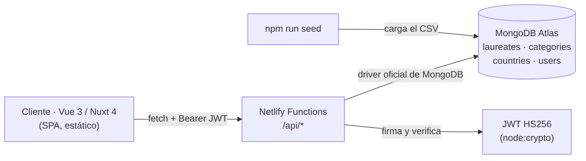

# Catálogo temático de los Premios Nobel — Proyecto 2

**Estudiante:** Kristel Duarte Pérez
**Carné:** 119010766
**Curso:** Arquitectura de Información
**Sitio publicado:** _pendiente de despliegue_
**Repositorio:** _pendiente_

Aplicación web con un **servicio REST propio** para consultar y administrar un
catálogo temático de los Premios Nobel. El servicio corre como **Netlify
Functions**, guarda la información en **MongoDB Atlas** y protege las
operaciones de escritura con **autenticación JWT**. El cliente está hecho con
**Vue 3 (Nuxt 4)**.

---

## 1. Qué resuelve

| Requisito del proyecto | Cómo se cumple |
| --- | --- |
| 1 entidad principal y 2 secundarias | `laureates` (principal), `categories` y `countries` (secundarias) |
| Al menos 4 campos por entidad | `laureates`: 11 campos · `categories`: 8 · `countries`: 6 |
| 12 registros de la principal, 6 de cada secundaria | 1023 galardonados · 6 categorías · 72 países |
| Referencias navegables entre entidades | `laureate.categoryId` → `categories`, `laureate.countryId` → `countries` |
| Imágenes en las entidades | retratos SVG generados por la API + banderas reales por país |
| Listar y consultar registros | `GET /api/{recurso}` y `GET /api/{recurso}/:id` |
| Crear, editar y borrar | `POST`, `PUT`, `DELETE` protegidos con JWT |
| Frontend en Vue.js para cada entidad | `/laureates`, `/categories`, `/countries` + panel `/admin` |
| Servicio desplegado en la nube | Netlify Functions + MongoDB Atlas |
| README con nombre y enlace | este archivo |

---

## 2. Arquitectura



* El **frontend** es una SPA que se genera como sitio estático y consulta la API
  desde el navegador. No contiene lógica de datos: todo pasa por el servicio.
* El **servicio** son cuatro Netlify Functions (`auth`, `laureates`,
  `categories`, `countries`) más dos auxiliares (`stats`, `images`), con la
  lógica común en `lib/`.
* La **base de datos** es MongoDB Atlas; las referencias se guardan como
  `ObjectId` y se resuelven en el servidor con `$lookup`.

```
app/                    Frontend (Vue 3 + Nuxt)
  components/           HeaderView, FooterView, LaureateCard, CountryCard, AlertBox…
  composables/          useApi.ts (cliente HTTP), useAuth.ts (sesión JWT)
  middleware/auth.ts    protege las rutas /admin
  pages/                vistas públicas + panel de administración
  utils/                formato de fechas, sesión en localStorage
netlify/functions/      La API REST (una función por recurso)
lib/                    Código compartido por las funciones
  db.mjs                conexión cacheada a MongoDB
  security.mjs          JWT HS256 + hashing scrypt
  auth.mjs              validación del Bearer y de roles
  validate.mjs          validación declarativa de los cuerpos JSON
  resource.mjs          paginación, poblado de referencias, errores
  http.mjs              respuestas JSON, CORS, errores HTTP
scripts/                seed.mjs, dev-api.mjs, test-api.mjs, build-dataset.mjs
content/                dataset original (CSV + JSON de categorías)
```

---

## 3. Modelo de datos

**Base:** `nobel` (configurable con `MONGODB_DB`).

### `laureates` — entidad principal

| Campo | Tipo | Descripción |
| --- | --- | --- |
| `_id` | ObjectId | identificador |
| `laureate` | texto | nombre de la persona u organización |
| `slug` | texto único | identificador legible para la URL |
| `gender` | `male` / `female` / `org` | tipo de galardonado |
| `year` | número | año del premio |
| `categoryId` | ObjectId → `categories` | **referencia** |
| `countryId` | ObjectId → `countries` | **referencia** (opcional) |
| `motivation` | texto | motivación oficial |
| `affiliation` | texto | institución |
| `birthDate`, `deathDate` | `AAAA-MM-DD` | fechas |
| `birthPlace`, `birthCountryRaw` | texto | lugar y país tal como figuran en el dataset |
| `portraitUrl` | texto | imagen del galardonado |
| `createdAt`, `updatedAt`, `createdBy` | fecha / texto | auditoría |

### `categories` — entidad secundaria

`_id`, `key` (único), `name`, `fullname`, `ordinal`, `color`, `icon`,
`description`, `image`.

### `countries` — entidad secundaria

`_id`, `code` (ISO 3166-1 alfa-2, único), `name` (único), `region`, `capital`,
`flag`, `description`.

### `users`

`_id`, `name`, `email` (único), `passwordHash` (scrypt), `role`
(`admin` | `editor`), `createdAt`.

**Índices:** `users.email`, `categories.key`, `countries.code`,
`countries.name`, `laureates.slug` (únicos) y `laureates.year`,
`laureates.categoryId`, `laureates.countryId` (de consulta), además de un índice
de texto sobre `laureate`, `motivation` y `affiliation`.

---

## 4. API REST

Todas las respuestas son JSON. Las listas devuelven `{ data, meta }` con
`page`, `limit`, `total`, `pages`; los errores devuelven
`{ error: { code, message, details? } }`.

| Método | Ruta | Auth | Descripción |
| --- | --- | --- | --- |
| `POST` | `/api/auth/register` | — | crea la cuenta y devuelve el token |
| `POST` | `/api/auth/login` | — | devuelve el token (8 horas) |
| `GET` | `/api/auth/me` | Bearer | datos de la sesión actual |
| `GET` | `/api/laureates` | — | listado con `page`, `limit`, `q`, `category`, `country`, `gender`, `year`, `sort` |
| `GET` | `/api/laureates/:id` o `:slug` | — | registro individual con referencias resueltas |
| `POST` | `/api/laureates` | Bearer | crear |
| `PUT` | `/api/laureates/:id` | Bearer | editar |
| `DELETE` | `/api/laureates/:id` | **admin** | borrar |
| `GET/POST/PUT/DELETE` | `/api/categories[/:key]` | — / Bearer / admin | categorías |
| `GET/POST/PUT/DELETE` | `/api/countries[/:code]` | — / Bearer / admin | países |
| `GET` | `/api/stats` | — | agregaciones para la portada y la vista por año |
| `GET` | `/api/images/laureate.svg` | — | retrato SVG generado |

Ejemplos:

```bash
# listado filtrado y paginado
curl "https://TU-SITIO.netlify.app/api/laureates?category=physics&page=2&limit=10"

# acceso
curl -X POST "https://TU-SITIO.netlify.app/api/auth/login" \
  -H "Content-Type: application/json" \
  -d '{"email":"admin@catalogo-nobel.test","password":"Nobel2026!"}'

# creación (requiere el token devuelto por /login)
curl -X POST "https://TU-SITIO.netlify.app/api/laureates" \
  -H "Authorization: Bearer $TOKEN" -H "Content-Type: application/json" \
  -d '{"laureate":"Ejemplo","gender":"female","year":2025,
       "categoryId":"<ObjectId de una categoría>"}'
```

**Códigos de estado usados:** `200`, `201`, `400` (cuerpo inválido), `401` (sin
token o token vencido), `403` (rol insuficiente), `404`, `405`, `409`
(duplicado o referencia en uso), `422` (validación con detalle por campo),
`500`.

### Autenticación

* Contraseñas con **scrypt** (`node:crypto`) y sal aleatoria por usuario.
* Token **JWT HS256** firmado con `JWT_SECRET`: `sub`, `email`, `name`, `role`,
  `iat`, `exp` (8 h). Se verifica la firma con comparación en tiempo constante y
  se rechaza si `exp` ya pasó.
* El primer usuario registrado en una base vacía recibe el rol `admin`; los
  siguientes, `editor`.
* `editor` puede crear y editar; solo `admin` puede borrar.

---

## 5. Frontend

| Ruta | Contenido |
| --- | --- |
| `/` | portada con estadísticas, categorías, países y últimos premios |
| `/laureates` | entidad principal: búsqueda, filtros por categoría/país/género, orden y paginación (todo en el servidor) |
| `/laureates/:slug` | ficha con retrato, categoría, país, fechas y premios del mismo año |
| `/categories` · `/categories/:key` | entidad secundaria |
| `/countries` · `/countries/:code` | entidad secundaria |
| `/years` · `/years/:year` | navegación temporal derivada de `/api/stats` |
| `/login` · `/register` | autenticación |
| `/admin` · `/admin/laureates` · `/admin/categories` · `/admin/countries` | panel con alta, edición y borrado (requiere sesión) |

El token se guarda en `localStorage`; al recargar, `useAuth().restore()` lo
valida contra `/api/auth/me` y cierra la sesión si ya no sirve.

---

## 6. Ejecución local

Requisitos: **Node.js ≥ 20.19** y un clúster de MongoDB (Atlas o local).

```bash
npm install
cp .env.example .env      # completa MONGODB_URI y JWT_SECRET
npm run seed              # carga 1023 galardonados, 6 categorías y 72 países
```

Después, en **dos terminales**:

```bash
npm run dev:api           # API en http://127.0.0.1:8787/api
npm run dev               # frontend en http://localhost:3000 (reenvía /api)
```

> `npm run dev:api` es un servidor que emula el enrutamiento de Netlify
> Functions para poder trabajar sin desplegar.

Otros comandos:

```bash
npm run seed -- --reset          # vacía y recarga
npm run seed -- --limit 30       # carga parcial (pruebas)
npm run generate                 # genera el sitio estático en .output/public
npm install --no-save mongodb-memory-server
node scripts/test-api.mjs        # 60 pruebas de integración contra un Mongo efímero
```

### Variables de entorno

| Variable | Obligatoria | Uso |
| --- | --- | --- |
| `MONGODB_URI` | sí | cadena de conexión de Atlas |
| `MONGODB_DB` | no | nombre de la base (por defecto `nobel`) |
| `JWT_SECRET` | sí | secreto de firma (mínimo 16 caracteres) |
| `SEED_ADMIN_EMAIL` / `SEED_ADMIN_PASSWORD` | no | cuenta inicial que crea el seed |

---

## 7. Despliegue en Netlify

1. Conectar el repositorio en Netlify (build `npm run generate`,
   publicación `.output/public`; ya está en `netlify.toml`).
2. En **Site configuration → Environment variables** definir `MONGODB_URI` y
   `JWT_SECRET` (nunca en el código ni en el zip).
3. En MongoDB Atlas, permitir el acceso de red de Netlify
   (*Network Access* → `0.0.0.0/0`, o las IPs del servicio).
4. Ejecutar `npm run seed` una vez, en local, apuntando al clúster de producción.

`netlify.toml` redirige `/api/*` a las funciones y deja un *fallback* SPA para
las rutas del cliente.

---

## 8. Decisiones y limitaciones

* **Los estados históricos del dataset** (`Prussia`, `USSR`, `Austria-Hungary`…)
  se asocian al país actual que los sucede para poder crear la referencia
  `countryId`; el texto original se conserva en `birthCountryRaw`.
* **Las imágenes no vienen en el dataset**: los retratos son SVG generados por
  `/api/images/laureate.svg` (iniciales + color de la categoría) y las banderas
  se sirven desde `flagcdn.com` a partir del código ISO. Se puede reemplazar el
  campo `portraitUrl` por una URL propia.
* **Borrado protegido por integridad referencial**: no se puede eliminar una
  categoría o un país con galardonados asociados (la API responde `409`).
* **No hay revocación de tokens**: al ser JWT sin estado, cerrar sesión borra el
  token del navegador; el servidor lo seguiría aceptando hasta su expiración
  (8 h).
* **Consultas sin caché**: cada vista consulta la API en tiempo real; se
  prioriza mostrar el efecto del CRUD sobre el rendimiento.
* El panel de administración vive en el mismo frontend para mantener un solo
  cliente, pero cada entidad tiene su propia vista y su propio formulario.

---

## 9. Atribución

Datos de los galardonados: **Nobel Prize Outreach AB / The Nobel Foundation**,
obtenidos de la API pública <https://api.nobelprize.org/2.1/laureates> y
utilizados bajo licencia
[CC BY 4.0](https://www.nobelprize.org/about/terms-of-use-for-api-nobelprize-org-and-data-nobelprize-org/).
Banderas: [flagcdn.com](https://flagcdn.com).
